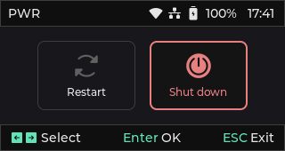
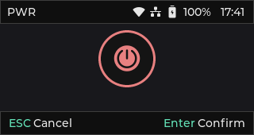

# PWR

A small APPLaunch app for **Cardputer Zero**: pick Restart or Shut down, confirm, done.

It asks once, then runs the usual `systemctl reboot` / `systemctl poweroff` path. Store share code: **POWR**.

<p align="center">
  
  &nbsp;
  
</p>

## Controls

| Key | Home | Confirm |
| --- | --- | --- |
| `Left` / `Right` (or `Z` / `C`) | Focus Restart / Shut down | — |
| `Enter` | Open confirm for the focused action | Confirm |
| `6` | Toggle light / dark | — |
| hold `ESC` / `4` | Exit | — |
| `ESC` | — | Cancel |

You can also tap an icon to jump straight to its confirm screen.

## Install

Grab an arm64 `.deb` from [Releases](https://github.com/mohamedation/pwr/releases) or the latest CI **pwr-arm64-deb** artifact, then on the device:

```shell
sudo apt install --no-install-recommends ./PWR_0.1.0_rev1_arm64.deb
```

Building from source, packaging, the desktop simulator, and store publish steps live in [development.md](./development.md).

## License

MIT — see [LICENSE](./LICENSE). Third-party font licenses are in `assets/fonts/LICENSE.txt`.
